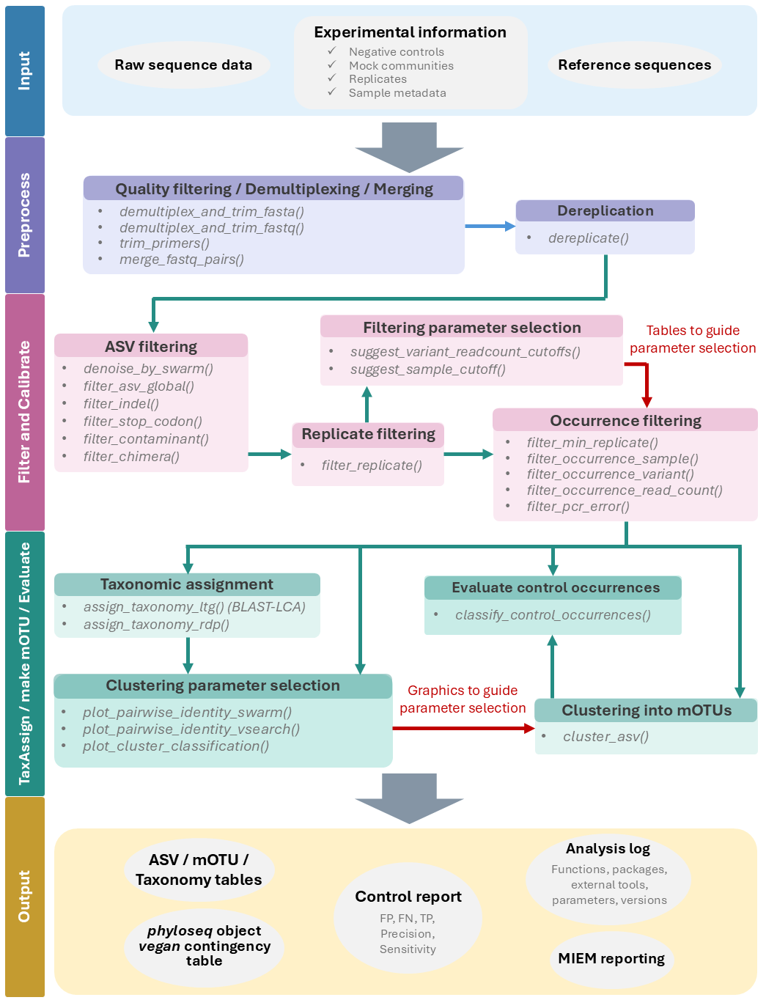

<!-- README.md is generated from README.Rmd. Please edit that file -->

# vtamR

<!-- badges: start -->
<!-- badges: end -->

**vtamR** is an advanced, R-based revision of
[VTAM](https://spj.science.org/doi/pdf/10.1016/j.csbj.2023.01.034)
(Validation and Taxonomic Assignment of Metabarcoding Data). It provides
a **comprehensive metabarcoding pipeline**, enabling:

-   **End-to-End Sequence Analysis:** Processes raw FASTQ files of
    amplicon sequences to generate a validated [Amplicon Sequence
    Variant
    (ASV)](https://meglecz.github.io/vtamR/articles/23-glossary.html#asv)
    table, with ASVs assigned to taxonomic groups.
-   **Replicate Handling:** Supports technical or biological replicates
    of the same sample.
-   **Control-Based Filtering:** Uses positive and negative control
    samples to refine filtering, minimizing both [false
    positives](https://meglecz.github.io/vtamR/articles/23-glossary.html#fp)
    and [false
    negatives](https://meglecz.github.io/vtamR/articles/23-glossary.html#fn).

**Novelties Compared to VTAM**

-   **Modular Design:** As a series of R functions, `vtamR` is **highly
    adaptable**, allowing users to include, exclude, or reorder analysis
    steps as needed.
-   **More Flexible Preprocessing:** Demultiplexing and subsampling of
    FASTA or FASTQ pairs.
-   **Denoising with SWARM:** Incorporates SWARM for robust denoising of
    amplicon sequence variants (ASVs).
-   **Post-Processing of Swarms:** Splits swarms among abundant ASVs to
    prevent pooling of highly similar yet distinct ASVs, preserving
    **intra-specific variability**.
-   **Visualization Tools:** Offers **graphic options** to aid in data
    interpretation and decision-making.
-   **Filtering Statistics:** Includes functions to generate
    **statistics for each filtering step** (e.g., read and variant
    counts).
-   **ASV Clustering into mOTUs:**
    -   Uses **VSEARCH or SWARM** to cluster ASVs into molecular
        operational taxonomic units (mOTUs).
    -   Provides visualization tools to help users **select optimal
        clustering parameters**.
-   **Simplified Workflow:** The concepts of “marker” and “run” have
    been removed to streamline analyses.
-   **Detailed Log File:** Records all major functions called, along
    with their parameters and runtimes.
-   **Summary Information:** Facilitates publication of results (e.g.,
    MIEM checklist).
-   **Flexible Output:** Formats output for direct use with `phyloseq`
    or `vegan`.

## Documentation

Detailed documentation is available in the
**[Manual](https://meglecz.github.io/vtamR/)**.

### Installation

Follow the detailed instructions on the
[Installation](https://meglecz.github.io/vtamR/articles/01-installation.html)
page.

### Tutorials

> The three tutorials follow the same workflow and demonstrate the use
> of the majority of vtamR functions. They provide a working example of
> a complete metabarcoding pipeline, starting from raw fastq sequences
> and ending with validated occurrences ready for downstream analyses.
> They also produce a variety of outputs for documenting the analyses,
> along with summaries that facilitate publication of the results.

-   [Quick
    Start](https://meglecz.github.io/vtamR/articles/02-quickstart.html):
    Just copy-paste the script into R and run it. It tests whether your
    installation is working correctly, and the output gives a good idea
    of the information you can obtain from the pipeline.
-   [Tutorial](https://meglecz.github.io/vtamR/articles/03-tutorial.html):
    A step-by-step tutorial without long explanations, but with links to
    the in-depth tutorial when you need them.
-   [Tutorial:
    In-Depth](https://meglecz.github.io/vtamR/articles/04-tutorial-in-depth.html):
    A step-by-step tutorial with detailed explanations of each function,
    its parameters, and its outputs.

### How-To Guides and Other Help

Dedicated pages to help you find further information:

-   [Examples of
    preprocessing](https://meglecz.github.io/vtamR/articles/10-howto-fastq-to-df.html)
-   [How to prepare a mock composition
    file](https://meglecz.github.io/vtamR/articles/11-howto-mock-composition-file.html)
-   [How to select parameters for the occurrence
    filters](https://meglecz.github.io/vtamR/articles/12-howto-select-parameters.html)
-   [How to pool different
    datasets](https://meglecz.github.io/vtamR/articles/13-howto-pool-datasets.html)
-   [Best
    Practices](https://meglecz.github.io/vtamR/articles/20-best-practices.html)
-   [Input-Output
    Formats](https://meglecz.github.io/vtamR/articles/21-ref-io-formats.html)
-   [Additional
    Functions](https://meglecz.github.io/vtamR/articles/22-ref-functions.html)
-   [Glossary](https://meglecz.github.io/vtamR/articles/23-glossary.html)
-   [Troubleshooting](https://meglecz.github.io/vtamR/articles/90-troubleshooting.html)

### Download Example Output

You can also download a ready-made example output (matching the output
of the tutorials) without running the pipeline:

``` r
vtamR::download_tutorial_output(dest = "Tutorial_output")
```

### vtamR workflow

<div class="figure" style="text-align: center">


<p class="caption">
Overview of the vtamR Workflow
</p>

</div>
