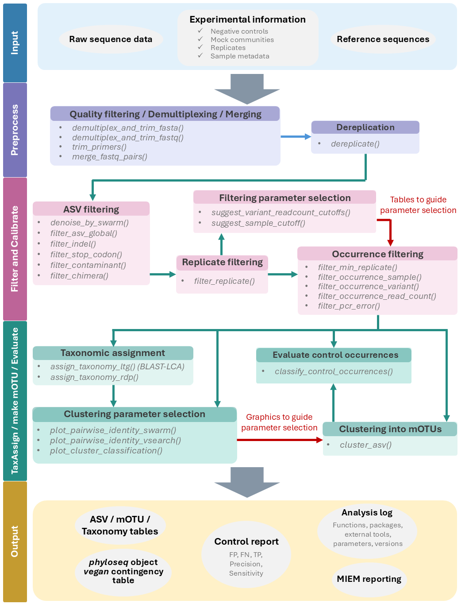

<style>
/* Block console output (<pre>) scrolls horizontally AND vertically */
pre {
  white-space: pre !important;        /* preserve spacing, no wrapping */
  overflow-x: auto !important;        /* horizontal scroll */
  overflow-y: auto !important;        /* vertical scroll */
  display: block;
  max-width: 100%;
  max-height: 500px;                  /* adjust height limit if you want */
  box-sizing: border-box;
}

/* Ensure code inside <pre> also stays fixed and scrollable */
pre code {
  white-space: pre !important;
}

/* TABLES: prevent wrapping, allow horizontal AND vertical scroll */
table {
  display: block;
  overflow-x: auto !important;
  overflow-y: auto !important;
  white-space: nowrap;                /* no wrapping of table cells */
  max-width: 100%;
  max-height: 500px;                  /* adjust as you like */
  box-sizing: border-box;
}
</style>


```{r, include = FALSE}
knitr::opts_chunk$set(
  collapse = TRUE,
  message = TRUE,
  warning = TRUE,
  echo=TRUE,
  eval=TRUE,
  cache=FALSE,
  fig.width = 6,
  out.width = '100%',
  comment = "#>"
)

```

**Package version:** `r packageVersion("vtamR")`

> vtamR offers three tutorials that follow the same workflow and cover the majority of its functions, differing only in how much explanation is provided: a Quick Start, a step-by-step Tutorial, and an In-Depth Tutorial (see links below).
>
> **This is the step-by-step Tutorial.** It walks you through the complete metabarcoding pipeline — from raw fastq sequences to validated occurrences ready for downstream analyses — with a short explanation at each step, but without going into detail on every function, parameter, or output. Along the way you'll also generate a variety of outputs for documenting your analyses and summaries that facilitate publishing your results. Wherever you'd like more depth, follow the links to the 
[In-Depth Tutorial](04-tutorial-indepth.html). 
If you just want to confirm your installation works, try the 
[Quick Start](02-quickstart.html) instead.


```{r, out.width="100%", fig.align="center", echo=FALSE, fig.cap="Overview of the vtamR Workflow"}

```

# Set up

## Load library

```{r}
library(vtamR)
library(dplyr)
```


## Set paths (if needed)

If the third-party tools are not in your PATH, set the corresponding package options and specify the correct path to each tool.
For more information see the [Best Practice page](20-best-practices.html#set-path)

```{r, eval=FALSE}
options(vtamR.vsearch_path = "C:/Users/Public/vsearch-2.23.0-win-x86_64/bin/vsearch")
options(vtamR.blast_path = "blastn")
options(vtamR.cutadapt_path = "C:/Users/Public/cutadapt")
options(vtamR.swarm_path = "C:/Users/Public/swarm-3.1.5-win-x86_64/bin/swarm")
options(vtamR.pigz_path = "C:/Users/Public/pigz-win32/pigz")
```

# Input data
*See [Input data](04-tutorial-in-depth.html#input-data) for more details.*

## Demo data and Database

```{r}
fastq_dir <- system.file("extdata/demo/fastq", package = "vtamR")
fastqinfo <-  system.file("extdata/demo/fastqinfo_mfzr_plate1.csv", package = "vtamR")
mock_ncbi_fasta <- system.file("extdata/demo/mock_ncbi.fasta", package = "vtamR")
asv_list <-  system.file("extdata/demo/asv_list.csv", package = "vtamR")

taxonomy <- system.file("extdata/db_test/taxonomy_reduced.tsv", package = "vtamR")
blast_db <- system.file("extdata/db_test", package = "vtamR")
blast_db <- file.path(blast_db, "COInr_reduced")
```

# Output
*See [Input data](04-tutorial-in-depth.html#output-directory) for more details.*

```{r}
outdir <- file.path("vtamR_demo_out", "tutorial")
options(vtamR.log_file =  file.path(outdir, "run_info", "vtamR_log.csv"))
```

# Preprocessing

## Demultiplex
*See [Demultiplex and Trim](04-tutorial-in-depth.html#demultiplex) for more details.*

```{r}
demultiplexed_dir <- file.path(outdir, "1_demultiplexed")

fastqinfo_demultiplexed <- demultiplex_and_trim_fastq(
  fastqinfo = fastqinfo, 
  fastq_dir = fastq_dir,  # directory of input fastq files
  outdir = demultiplexed_dir,  # directory of output fastq files
  primer_to_end = FALSE,
  check_reverse = TRUE,
  compress = FALSE
  )
```

## Subsampling
*See [Subsampling](04-tutorial-in-depth.html#subsampling) for more details.*

Use `random_sample_batch_by` and the `N` option.
This allow the select `N` sequences all together from the files of each `replicate` (befined by the `by` argument),
while keeping the relative proportion of the read count among the files of the same 
replicate.

```{r}
randomseq_dir <- file.path(outdir, "2_random_sampled")

fastqinfo_subsampled <- random_sample_batch_by(
  info = fastqinfo_demultiplexed,
  by = "replicate",
  dir = demultiplexed_dir,  # directory of input fastq files
  outdir = randomseq_dir,  # directory of output fastq files
  N = 37000,
  compress = FALSE,
  randseed = 123 # use the same random seed for reproducibility
  ) 
```

## Merge Fastq Pairs
*See [Merge Fastq Pairs and Quality Filter](04-tutorial-in-depth.html#merge) for more details.*

```{r}
merged_dir <- file.path(outdir, "3_merged")

sampleinfo_df <- merge_fastq_pairs(
  fastqinfo = fastqinfo_subsampled, 
  fastq_dir = randomseq_dir, # directory of input fastq files
  outdir = merged_dir, # directory of output fasta files
  fastq_maxee = 1, # Maximum Expected Error for each read
  fastq_maxns = 0, # no Ns in output
  compress = FALSE,
  fastq_allowmergestagger = T # reads might be longer than the marker
  )
```

> Important: Managing Large Files
Once your analysis is complete, you might want 
to compress or delete large intermediate files. 
For tips on this, see [Files to Keep](20-best-practices.html#files-to-keep).

## Dereplicate
*See [Dereplicate](04-tutorial-in-depth.html#dereplicate) for more details.*
Group identical sequences so that each unique sequence (an [ASV](23-glossary.html#asv)) is assigned a 
unique numerical ID (an [asv_id](23-glossary.html#asv_id)) and count the number of reads corresponding to each ASV in each sample.

To keep **ASV IDs consistent across different datasets**, use the `input_asv_list` and `output_asv_list`.
See the [Consistent ASV IDs across datasets](14-howto-asv-id-across-datasets.html) section for more information.

```{r}
outfile <- file.path(outdir, "4_filter", "1_before_filter.csv")
output_asv_list <- file.path(outdir, "Updated_asv_list_mfzr_plate1.csv")

read_count_df <- dereplicate(
  sampleinfo = sampleinfo_df, # input df (output of demultiplex_and_trim_fasta)
  dir = merged_dir, # directory with input fasta files
  outfile = outfile, # write the output data frame to this file
  input_asv_list = asv_list,
  output_asv_list = output_asv_list
  )
```


# Filtering
*See [Filtering](04-tutorial-in-depth.html#filtering) for more details.*

## Initialize Statistics
*See [Initialize Statistics](04-tutorial-in-depth.html#init-stat) for more details.*

```{r}
stat_df <- data.frame(
  parameters = character(),
  asv_count = integer(),
  read_count = integer(),
  sample_count = integer(),
  sample_replicate_count = integer()
)

stat_df <- get_stat(read_count_df, stat_df, stage = "input", params = NA)
```

## Filtering ASVs
Remove ASV from all samples.

### Denoising
*See [Denoising with SWARM](04-tutorial-in-depth.html#denoise) for more details.*

Use SWARM for denoising, followed by a post-processing step that splits clusters by separating out ASVs that are highly abundant relative to the cluster centroid, to preserve intraspecific diversity (`split_clusters = TRUE`).

```{r}
split_clusters <- TRUE
by_sample <- TRUE

outfile <- file.path(outdir, "4_filter", "2_swarm_denoise.csv")
read_count_df <- denoise_by_swarm(
  read_count = read_count_df,
  outfile=outfile,
  by_sample=by_sample,
  split_clusters=split_clusters,
  quiet=TRUE
  )

param <- paste("by_sample:", by_sample, "split_clusters:", split_clusters, sep=" ")
stat_df <- get_stat(read_count_df, stat_df, stage="swarm_denoise", params=param)
```

### Filter ASVs Global
*See [Filter out ASVs with Low Total Read Count](04-tutorial-in-depth.html#filter_asv_global) for more details.*
Remove singletons (`global_read_count_cutoff = 2`).

```{r}
global_read_count_cutoff = 2
outfile <- file.path(outdir, "4_filter", "3_filter_asv_global.csv")

read_count_df <- filter_asv_global(
  read_count = read_count_df, 
  outfile = outfile, 
  cutoff = global_read_count_cutoff
  )

param <- paste("global_read_count_cutoff:", global_read_count_cutoff)
stat_df <- get_stat(read_count_df, stat_df, stage="filter_asv_global", params=param)
```

### Filter ASVs Read Length
*See [Filter ASVs Based on Read Length](04-tutorial-in-depth.html#filter_indel) for more details.*

Filter out ASVs whose length differs from the most frequent ASV length by a value that is not a multiple of 3.

```{r}
outfile <- file.path(outdir, "4_filter", "4_filter_indel.csv")

read_count_df <- filter_indel(
  read_count = read_count_df, 
  outfile = outfile
  )
stat_df <- get_stat(read_count_df, stat_df, stage="filter_indel", params=NA)
```

### Filter ASVs Stop Codons
*See [Filter ASVs with Stop Codons](04-tutorial-in-depth.html#filter_stop_codon) for more details.*
Filter out ASVs that contain STOP codons in every reading frame.

```{r}
outfile <- file.path(outdir, "4_filter", "5_filter_stop_codon.csv")

read_count_df <- filter_stop_codon(
  read_count = read_count_df, 
  outfile = outfile
  )

stat_df <- get_stat(read_count_df, stat_df, stage="filter_stop_codon", params=NA)
```

### Filter Contaminant ASVs
*See [Filter Potential Contaminant ASVs](04-tutorial-in-depth.html#filter_contaminant) for more details.*
Remove likely contaminants: ASVs with more reads in a negative control than in any biological sample.

```{r}
outfile <- file.path(outdir, "4_filter", "6_filter_contaminant.csv")
conta_file <- file.path(outdir, "4_filter", "potential_contaminants.csv")

read_count_df <- filter_contaminant(
  read_count = read_count_df,
  sampleinfo = sampleinfo_df,
  conta_file = conta_file,
  outfile = outfile
)

stat_df <- get_stat(read_count_df, stat_df, stage="filter_contaminant", params=NA)
```

### Filter Chimeric ASVs
*See [Filter Chimeric ASVs](04-tutorial-in-depth.html#filter_chimera) for more details.*

```{r}
outfile <- file.path(outdir, "4_filter", "7_filter_chimera.csv")

read_count_df <- filter_chimera(
  read_count = read_count_df,
  outfile = outfile
)

stat_df <- get_stat(read_count_df, stat_df, stage="filter_chimera", params=NA)
```

## Filter Replicates
*See [Filter Aberrant Replicates](04-tutorial-in-depth.html#filter_replicate) for more details.*

Remove replicates that are outliers within their sample, i.e. highly dissimilar (Renkonen distance) to most other replicates.

```{r}
outfile <- file.path(outdir, "4_filter", "8_filter_replicate.csv")
renkonen_distance_quantile <- 0.9

read_count_df <- filter_replicate(
  read_count = read_count_df,
  renkonen_distance_quantile = renkonen_distance_quantile,
  outfile = outfile
)

param <- paste("renkonen_distance_quantile:", renkonen_distance_quantile)
stat_df <- get_stat(read_count_df, stat_df, stage="filter_replicate", params=param)
```

## Create `mock_composition` File
*See [Create `mock_composition` File](04-tutorial-in-depth.html#match_variants_to_mock_species) for more details.*

[`mock_composition`](21-ref-io-formats.html#mock_composition) is a reference file listing the exact ASVs expected in each mock sample.

```{r}
outdir_mock <- file.path(outdir, "mock_composition")

mock_template <- match_variants_to_mock_species(
  read_count = read_count_df,
  fas = mock_ncbi_fasta,
  taxonomy = taxonomy,
  sampleinfo = sampleinfo_df,
  outdir = outdir_mock
)

mock_composition <- file.path(outdir_mock, "mock_composition_template_to_check.csv")
mock_composition_df <- read.csv(mock_composition)
```

## Filtering occurrences
Remove an ASV's presence in specific samples (or sample-replicates) without removing the ASV from the whole dataset.

### Filter Low-Abundance Occurrences within Samples
*See [Filter Low-Abundance Occurrences within Samples ](04-tutorial-in-depth.html#filter_occurrence_sample) for more details.*

#### Suggest Filter Parameters Based on Mock Sample (`suggest_sample_cutoff`) 

Calculate the proportion of reads assigned to the expected ASV relative to the total reads in each sample replicate, then set a cutoff below the minimum proportion.

```{r}
outfile = file.path(outdir, "4_filter", "suggest_parameters", "sample_cutoff.csv")

suggest_sample_cutoff_df <- suggest_sample_cutoff(
  read_count = read_count_df,
  mock_composition = mock_composition,
  outfile = outfile
)

head(suggest_sample_cutoff_df, n=12)
```

#### Filter Low-Abundance Occurrences within Samples 
Remove occurrences where the relative abundance within the sample-replicate is below `cutoff`. 

```{r}
sample_cutoff <- 0.005
outfile <- file.path(outdir, "4_filter", "9_filter_occurrence_sample.csv")

read_count_df <- filter_occurrence_sample(
  read_count = read_count_df, 
  cutoff = sample_cutoff, 
  outfile = outfile
  )

param <- paste("cutoff:", sample_cutoff)
stat_df <- get_stat(read_count_df, stat_df, stage="filter_occurrence_sample", params=param)
```

### Filter Occurrences by Replicate
*See [Filter Occurrences by Replicate Consistency](04-tutorial-in-depth.html#filter_min_replicate-1) for more details.*

Remove occurrences where an ASV is not present in at least 2 replicates of the sample (`min_replicate_number = 2`).

```{r}
min_replicate_number <- 2
outfile <- file.path(outdir, "4_filter", "10_filter_min_replicate.csv")

read_count_df <- filter_min_replicate(
  read_count = read_count_df, 
  cutoff = min_replicate_number, 
  outfile = outfile
  )

param <- paste("cutoff:", min_replicate_number)
stat_df <- get_stat(read_count_df, stat_df, stage="filter_min_replicate", params=param)
```


### Filter Occurrences by Variant and Read count

*See [Filter Low-Abundance Occurrences (`filter_occurrence_variant` and `filter_occurrence_read_count`)](04-tutorial-in-depth.html#filter_occurrence_variant) for more details.*

#### Choose a Cutoff for (`filter_occurrence_variant` and `filter_occurrence_read_count`)
Select the least stringent combination of the two filters that minimizes both false negatives and false positives.

```{r}
outdir_suggest = file.path(outdir, "4_filter", "suggest_parameters")

suggest_variant_readcount_cutoffs_df <- suggest_variant_readcount_cutoffs(
  read_count = read_count_df,
  mock_composition = mock_composition,
  sampleinfo = sampleinfo_df,
  outdir = outdir_suggest,
  min_replicate_number = 2
)

head(suggest_variant_readcount_cutoffs_df)
```

#### Apply `filter_occurrence_variant` and `filter_occurrence_read_count` 

Apply both filters to the same input data frame used to determine the cutoffs and
combine their results using `pool_filters`. Only occurrences passing both filters are retained.

**Filter occurrences by variant** 

```{r}
variant_cutoff = 0.001
outfile <- file.path(outdir, "4_filter", "11_filter_occurrence_variant.csv")

read_count_df_variant <- filter_occurrence_variant(
  read_count = read_count_df, 
  cutoff = variant_cutoff, 
  outfile = outfile
  )
param <- paste("variant_cutoff:", variant_cutoff)
stat_df <- get_stat(read_count_df, stat_df, stage="filter_occurrence_variant", params=param)
```

**Filter occurrences by read count**

```{r}
read_count_cutoff <- 10
outfile <- file.path(outdir, "4_filter", "12_filter_occurrence_read_count.csv")

read_count_df_rc <- filter_occurrence_read_count(
  read_count = read_count_df, 
  cutoff = read_count_cutoff, 
  outfile = outfile
  )
param <- paste("read_count_cutoff:", read_count_cutoff)
stat_df <- get_stat(read_count_df, stat_df, stage="filter_occurrence_read_count", params=param)
```

**Pool results**

```{r}
outfile <- file.path(outdir, "4_filter", "13_pool_filters.csv")

read_count_df <- pool_filters(
  read_count_df_rc, read_count_df_variant, 
  outfile=outfile
  )

rm(read_count_df_rc)
rm(read_count_df_variant)

stat_df <- get_stat(read_count_df, stat_df, stage="pool_filters", params=NA)
```


### Filter Occurrences by Replicate Consistency - 2

*See [Filter Occurrences by Replicate Consistency](04-tutorial-in-depth.html#filter_min_replicate-2) for more details.*

```{r}
min_replicate_number <- 2
outfile <- file.path(outdir, "4_filter", "14_filter_min_replicate.csv")

read_count_df <- filter_min_replicate(
  read_count = read_count_df, 
  cutoff = min_replicate_number, 
  outfile = outfile
  )
param <- paste("min_replicate_number:", min_replicate_number)
stat_df <- get_stat(read_count_df, stat_df, stage="filter_min_replicate", params=param)
```

# Final steps

## Pool replicates
*See [Pool replicates](04-tutorial-in-depth.html#pool_replicates) for more details.*

```{r}
outfile <- file.path(outdir, "4_filter", "15_pool_replicates.csv")

read_count_sample_df <- pool_replicates(
  read_count = read_count_df,
  method = "mean",   # Aggregate replicates using the mean read count
  outfile = outfile
)
```

## Performance Metrics
*See [Performance Metrics](04-tutorial-in-depth.html#classify_control_occurrences) for more details.*

```{r}
false_negatives <- file.path(outdir, "4_filter", "false_negatives.csv")
performance_metrics <- file.path(outdir, "4_filter", "performance_metrics.csv")
known_occurrences <- file.path(outdir, "4_filter", "known_occurrences.csv")

results <- classify_control_occurrences(
  read_count = read_count_sample_df, 
  sampleinfo = sampleinfo_df, 
  mock_composition = mock_composition, 
  known_occurrences = known_occurrences, 
  false_negatives = false_negatives,
  performance_metrics = performance_metrics
  )

known_occurrences_df <- results[[1]]
false_negatives_df <- results[[2]]
performance_metrics_df <- results[[3]]

knitr::kable(performance_metrics_df, format = "markdown")
```

## Print Summary Statistics
*See [Print Summary Statistics](04-tutorial-in-depth.html#print_stats) for more details.*
Number of reads, ASVs, samples, and replicates remaining after each filtering step.

```{r}
write.csv(stat_df, file = file.path(outdir, "run_info", "summary.csv"))
```


# Taxonomic Assignment
*See [Taxonomic Assignment](04-tutorial-in-depth.html#taxonomic-assignment) for more details.*

BLAST-based Last Common Ancestor (LCA) approach.

```{r}
outfile <- file.path(outdir, "4_filter", "assign_taxonomy_ltg.csv")

asv_tax <- assign_taxonomy_ltg(
  asv = read_count_sample_df,
  taxonomy = taxonomy,
  blast_db = blast_db,
  outfile = outfile
)
```

# Clustering (mOTUs)
*See [Clustering (mOTUs)](04-tutorial-in-depth.html#cluster_asv) for more details.*

## Chose clustering parameter

### Plot Pairwise Identity Distribution

```{r plot_pairwise_identity_vsearch}
outfile <- file.path(outdir, "5_cluster", "pairwise_identities_vsearch.csv")
plotfile <- file.path(outdir, "5_cluster", "plot_pairwise_identity_vsearch.png")

plot_vsearch <- plot_pairwise_identity_vsearch(
  read_count = read_count_sample_df,
  identity_min = 0.9,
  identity_max = 0.99,
  identity_increment = 0.01,
  min_id = 0.8, 
  outfile = outfile, 
  plotfile = plotfile)

print(plot_vsearch)
```

### Classify Clusters Based On Taxonomy

```{r plot_cluster_classification}
outfile <- file.path(outdir, "5_cluster", "classification_vsearch.csv")
plotfile <- file.path(outdir, "5_cluster", "plot_cluster_classification_vsearch.png")

scatterplot_vsearch <- plot_cluster_classification(
  read_count = read_count_sample_df,
  taxa = asv_tax,
  clustering_method = "vsearch",
  cluster_params = c(0.90, 0.91, 0.92, 0.93, 0.94, 0.95, 0.96, 0.97, 0.98, 0.99),
  taxlevels = c("species", "genus"),
  outfile = outfile,
  plotfile = plotfile)

print(scatterplot_vsearch)
```

## Cluster ASVs into mOTUs

```{r motu-clustersize}
outfile <- file.path(outdir, "5_cluster", "16_mOTU_vsearch.csv")
identity <- 0.97 
read_count_samples_df_ClusterSize <- cluster_asv(
  read_count = read_count_sample_df,
  method = "vsearch",
  identity = 0.97,
  group = TRUE,
  by_sample = FALSE,
  outfile = outfile)
```


# Output

## ASV table
*See [Output table](04-tutorial-in-depth.html#write_asv_table) for more details.*

```{r write_asv_table}
outfile=file.path(outdir, "motu_table_taxa.csv")

asv_table_df <- write_asv_table(
  read_count = read_count_sample_df, 
  outfile = outfile, 
  asv_tax = asv_tax, 
  sampleinfo = sampleinfo_df, 
  add_empty_samples = FALSE, 
  add_sums_by_sample = TRUE, 
  add_sums_by_asv = TRUE, 
  add_expected_asv = TRUE, 
  mock_composition = mock_composition)
```

## Convert output to a phyloseq object
*See [Convert output to a `phyloseq` object](04-tutorial-in-depth.html#phyloseq) for more details. *

```{r make_phyloseq}
# Create a data frame containing sample metadata
samples <- sampleinfo_df %>%
  select(sample, sample_type, habitat) %>%
  distinct()

phy_object <- format_for_phyloseq(
  otu = read_count_sample_df,
  tax = asv_tax,
  samples = sampleinfo_df,
  outfile = file.path(outdir, "phyloseq", "phyloseq.rds")
)
```

## Convert output for the `vegan` package
*See [Convert output to a `vegan` object](04-tutorial-in-depth.html#vegan) for more details. *

```{r format_to_vegan}
vegan_dfs <- format_for_vegan(
  otu = read_count_sample_df,
  tax = asv_tax,
  sample_type = sampleinfo_df,
  rm_coltrol = TRUE,
  outfile_motu = file.path(outdir, "vegan", "motu_table_vegan.csv"), 
  outfile_taxa = file.path(outdir, "vegan", "tax_table_vegan.csv")
)

vegan_motu_df <- vegan_dfs[[1]]
vegan_tax_df <- vegan_dfs[[2]]
```

# Document your workflow

## Record R and package versions 
*See [Record R and package versions](04-tutorial-in-depth.html#package-versions) for more details. *

```{r versions}
package_versions <- file.path(outdir, "run_info",  "R_package_versions.csv")
collect_package_info(package_versions)
```

## MIEM 
*See [MIEM](04-tutorial-in-depth.html#miem) for more details.*

### MIEM bioinformatics

```{r miem_bioinformatics}
miem_dir <- file.path(outdir, "run_info", "MIEM")
tmp <- miem_bioinformatics(
  r_versions = package_versions,
  outfile = file.path(miem_dir, "MIEM_bioinfo.csv")
  )
```


### MIEM Sequencing Summary

```{r miem_results}
info_files = c(
  fastqinfo,
  file.path(outdir, "1_demultiplexed/fastqinfo.csv"),
  file.path(outdir, "2_random_sampled/fastqinfo.csv"),
  file.path(outdir, "3_merged/fastainfo.csv")
)

read_count_files = c(
  file.path(outdir, "4_filter/1_before_filter.csv"),
  file.path(outdir, "4_filter/2_swarm_denoise.csv"),
  file.path(outdir, "4_filter/14_filter_min_replicate.csv"),
  file.path(outdir, "4_filter/15_pool_replicates.csv"),
  file.path(outdir, "5_cluster/16_mOTU_vsearch.csv")
)

taxa = file.path(outdir, "4_filter/assign_taxonomy_ltg.csv")

miem_results(
  info_files = info_files, 
  fastq_dir = fastq_dir, 
  read_count_files = read_count_files, 
  taxa = taxa, 
  outdir = miem_dir, 
  mock_composition = mock_composition
  )
```
